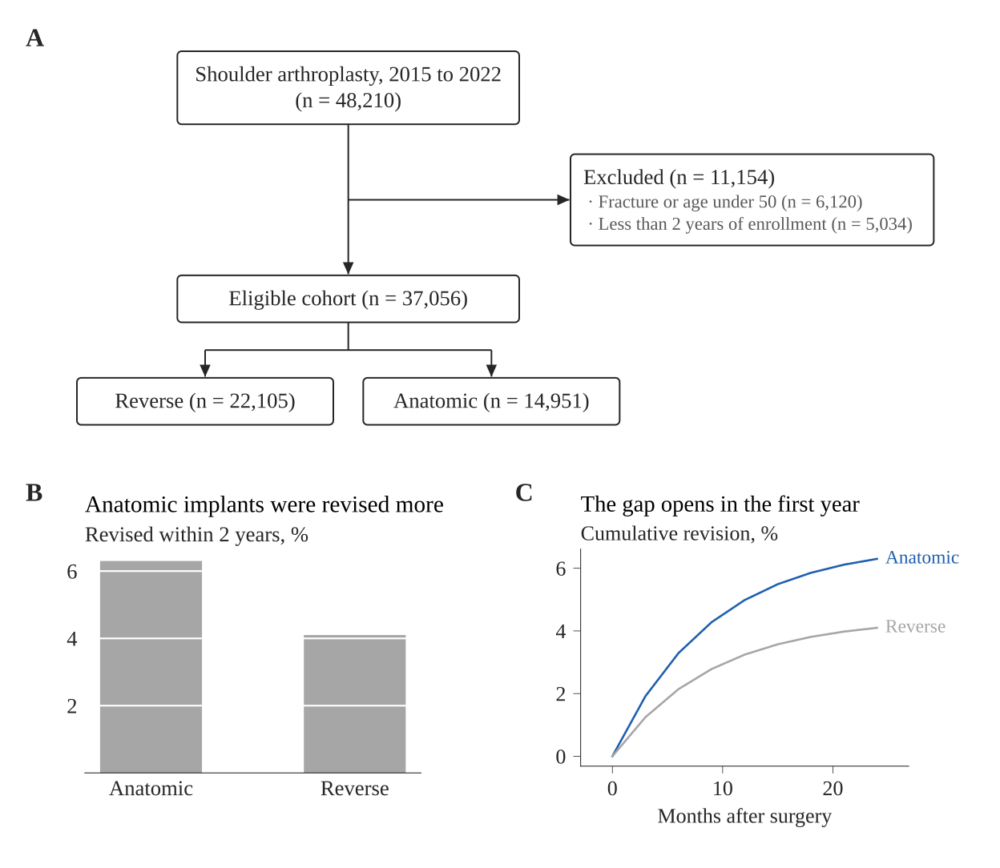
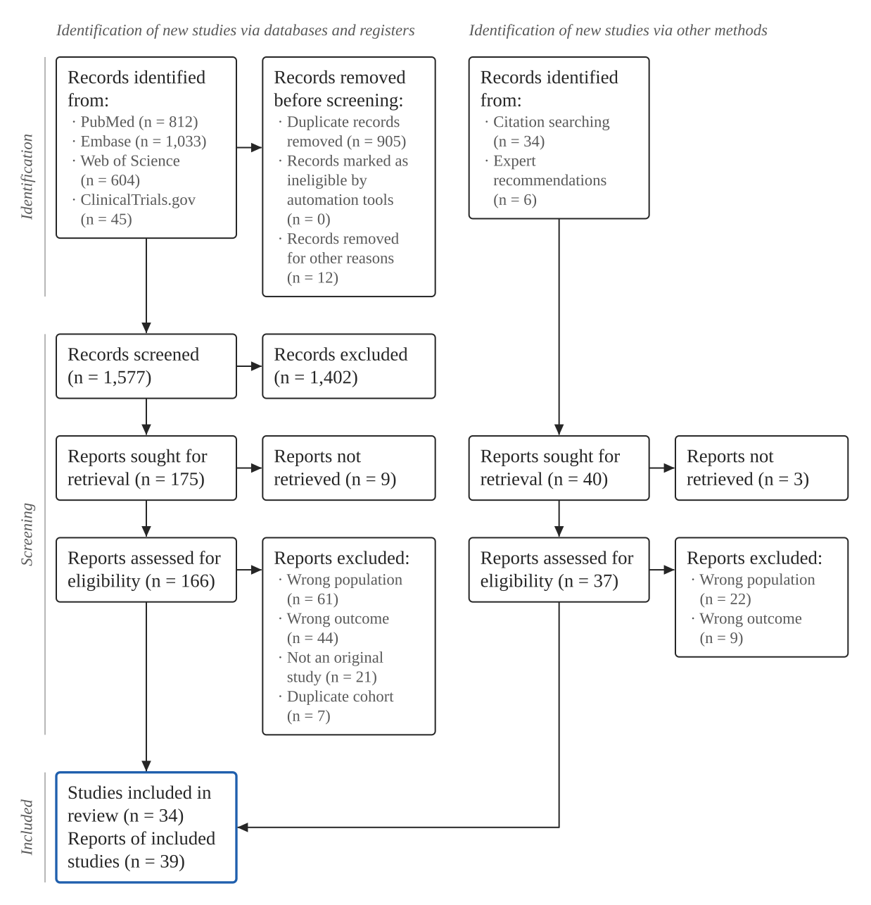
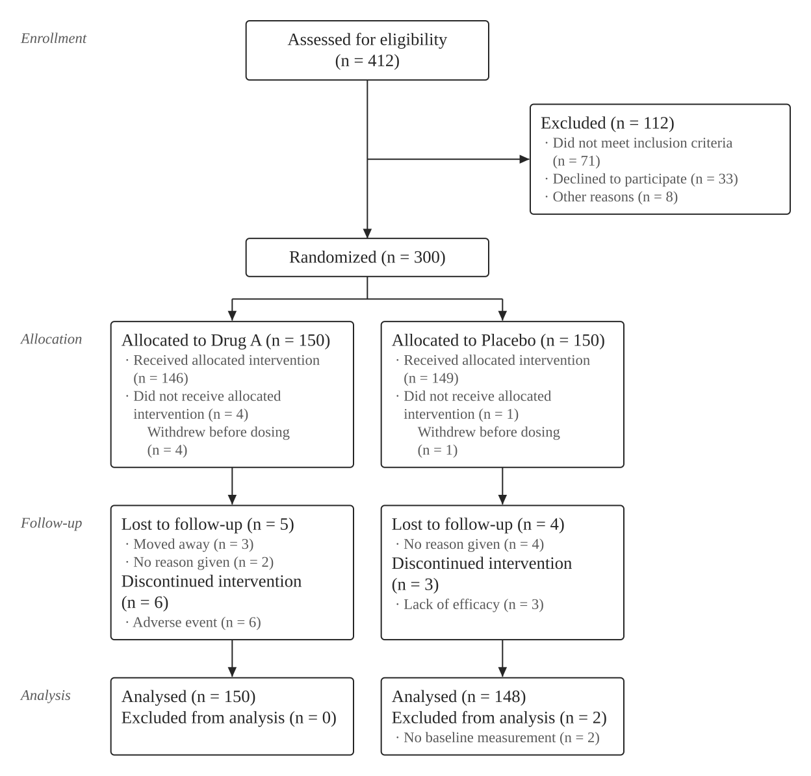
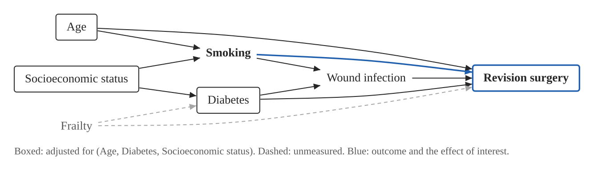
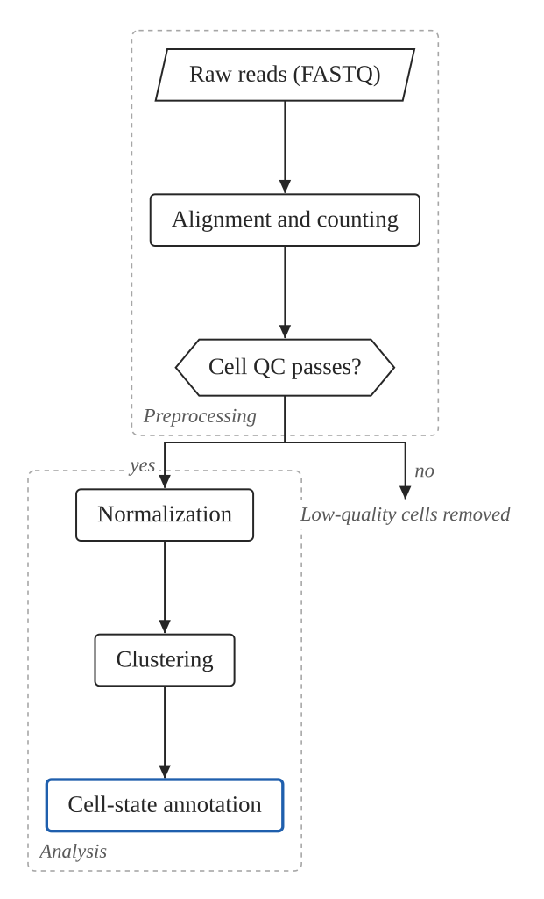

# FrameDesign

*Structure, drawn honestly.*

FrameDesign is a Claude skill, plus matching engines in pure R and pure Python, for drawing research diagrams: analysis pipelines, flowcharts, causal DAGs, CONSORT trial flow, PRISMA 2020 review flow, cohort selection flow, study timelines, and multi-panel figures. It is the companion to InkSight: InkSight draws quantities, FrameDesign draws structure, and both share one palette, one serif type stack and the same data-ink rules, so a diagram and a chart sit in one figure as if made by one hand.



*Panel A is FrameDesign; panels B and C are InkSight. All data are simulated.*

| PRISMA 2020 flow | CONSORT flow |
|---|---|
|  |  |

| Causal DAG | Analysis pipeline |
|---|---|
|  |  |

More: [study timeline](examples/output/06_timeline.png), [updated-review PRISMA](examples/output/10_prisma_update.png), [loop with a decision](examples/output/02_flow_loop.png), [cohort selection](examples/output/05_cohort.png), [slide-width pipeline](examples/output/07_pipeline_slide.png), [figure built entirely in R](examples/output/r_figure.png), [DAG drawn in R](examples/output/r_dag.png).

## What it does

- **Counts that add up.** CONSORT, PRISMA and cohort flows refuse to render when their numbers contradict each other, and say exactly which numbers disagree.
- **Formal causal checks.** DAGs are checked for cycles; the drawn adjustment set is tested against the backdoor criterion, every minimal sufficient adjustment set is listed, and the DAG exports to [dagitty](https://www.dagitty.net) for independent checking.
- **Layout you do not have to fix.** Boxes are sized from Times font metrics, crossings are minimised, nodes align with their neighbours, loops route around the side, and counts such as "(n = 48,210)" never break across lines.
- **A checker for any SVG.** Flags overlapping nodes, edges through nodes, labels crossed by lines, overflowing or tiny text, low contrast, red with green, identifiers (dates, MRNs, emails, phone numbers), and remote content.
- **InkSight tie-in.** `panels` combines FrameDesign diagrams with InkSight charts (ggplot2/svglite or matplotlib SVGs), letters the panels, makes ids unique, unifies fonts and warns when panels are at different scales.
- **R or Python, same result.** The pure-R engine needs only base R; the Python engine needs only the standard library. For the same spec they draw the same figure, checked by a parity test.
- **Safe by construction.** No network, no shell, no `eval`; output has no scripts, remote fonts or metadata.

Every rule and how it is enforced is in [`references/design-rules.md`](references/design-rules.md). All spec fields are in [`references/spec-reference.md`](references/spec-reference.md).

## Install as a Claude skill

1. Download this repository as a ZIP (or use the `FrameDesign.zip` release file).
2. In Claude, open the Skills settings and upload the ZIP. The folder must contain `SKILL.md` at its root.
3. Ask for a diagram, for example: "Draw the PRISMA flow for these numbers with the FrameDesign skill", or "Make Figure 1 with the cohort flow from FrameDesign and the revision-rate chart from InkSight."

## Use in RStudio (no Python needed)

```r
source("R/framedesign.R")               # base R only
cohort <- list(type = "cohort",
  start = list(label = "Shoulder arthroplasty, 2015 to 2022", n = 48210),
  steps = list(list(excluded = 11154, label = "Eligible cohort",
                    reasons = fd_reasons(c("Fracture or age under 50" = 6120,
                                           "Less than 2 years of enrollment" = 5034)))),
  groups = list(list(label = "Reverse", n = 22105), list(label = "Anatomic", n = 14951)))
fd_render(cohort, "fig_cohort.svg")
fd_check("fig_cohort.svg")              # character(0) means no issues
fd_png("fig_cohort.svg")                # needs the rsvg package
```

Causal DAG with a formal adjustment analysis:

```r
dag <- list(type = "dag",
  nodes = list(list(id = "Smoking", role = "exposure"), list(id = "Revision", role = "outcome"),
               list(id = "Age", role = "confounder", adjusted = TRUE),
               list(id = "Frailty", role = "unmeasured")),
  edges = list(list(from = "Smoking", to = "Revision"), list(from = "Age", to = "Smoking"),
               list(from = "Age", to = "Revision"), list(from = "Frailty", to = "Revision")))
fd_adjustment_sets(dag)                  # list(c("Age")): minimal sufficient sets
cat(fd_dagitty(dag))                     # paste into dagitty.net, or fd_dagitty(dag, object = TRUE)
fd_render(dag, "fig_dag.svg")
```

Combine with an InkSight chart:

```r
source("../inksight/R/inksight.R")
save_vdqi(p, "fig_rate.svg", width = 2.8, height = 2.8 / 1.5)   # p is an InkSight ggplot
fd_render(list(type = "panels", panels = list(
  list(span = 2, file = "fig_cohort.svg"), list(file = "fig_rate.svg"))), "figure1.svg")
```

JSON specs work too: `fd_render_json("examples/specs/09_prisma.json", "prisma.svg")` (needs jsonlite).

## Use from Python or the command line

```bash
python python/framedesign.py render examples/specs/09_prisma.json -o prisma.svg
python python/framedesign.py check prisma.svg
python python/framedesign.py dagitty examples/specs/03_dag.json
```

```python
import sys; sys.path.insert(0, "python")
import framedesign as fd
svg, findings = fd.render(spec)          # findings == [] means no issues
fd.write_svg(svg, "figure.svg")
```

## Verify

```bash
Rscript tests/test_framedesign.R        # base R; parity test needs jsonlite; tie-in test needs InkSight beside it
python -m pytest -q tests/              # or: python -m unittest discover tests (standard library only)
Rscript examples/demo.R                 # pure-R examples
python examples/demo.py                 # regenerates examples/output
```

## Privacy and security

- No network access, shell calls, `eval`, or deserialization anywhere in either engine.
- Output SVGs contain no scripts, links, remote fonts, or software and date metadata.
- SVGs brought in as panels are screened: entity declarations, scripts, event handlers, foreignObject and remote references are refused.
- Example data are simulated. `.gitignore` blocks data files so datasets are not committed by accident.
- The skill tells Claude never to put identifiers in a diagram and to flag counts below 11 in clinical flows.

## Credit and disclaimer

The data-ink principles are those of Edward R. Tufte, as summarized in InkSight. The participant and review flow layouts follow the CONSORT 2010 statement, the PRISMA 2020 statement and STROBE guidance; this project is not affiliated with or endorsed by any of these groups. The adjustment-set analysis implements the backdoor criterion of Judea Pearl; dagitty is by Johannes Textor and colleagues. The idea of an editorial, low-density diagram style and a self-check pass was inspired by [diagram-design](https://github.com/cathrynlavery/diagram-design) by Cathryn Lavery (MIT); FrameDesign is an independent rewrite and shares no code with it (see `NOTICE.md`). Code is released under the MIT License.
